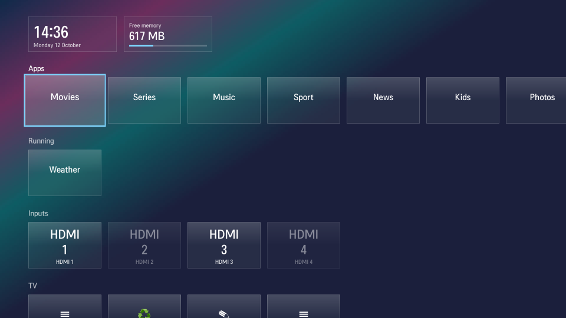

# elgie-man

A replacement Home screen for two rooted LG TVs: the CX on webOS 5.6.2 and the C5 on webOS 10.3.1 ("webOS 25"). Pressing Home shows this launcher instead of LG's Home: rows of apps, open apps and inputs, with no ads, promotions or recommendation rows.

It is not a copy of LG's Home. Some things behave differently ("What behaves differently"), and installing it changes more on the TV than a folder of files ("What it changes on the TV"). **Use it at your own risk.**



## How it runs

| TV | webOS | How |
|---|---|---|
| LG CX | 5.6.2 | LG's own Home program stays and loads the launcher's screens in place of LG's. |
| LG C5 | 10.3.1 | LG's Home app does not run. The TV's `qml-runner` runs the launcher under Home's app id. |

Both keep Home's app id, so the Home key still opens it. `docs/contract-cx.md` and `docs/contract-c5.md` record what each TV expects of a Home app, as observed.

## What behaves differently from LG's Home

- **Pause on Home.** Opening Home over an app first sends that app the remote's Pause, and Home appears when the app has answered (at most 0.7 s later; 1.6 s for apps that get Pause twice). Play is never sent. Switch: `pauseOnHome`.
- **CX, with `pauseUnderHome` on:** Home takes over the screen and the app under it goes to the background, where LG's Home sat on top of it. Back then reopens that app, or the last input if the app has closed. Some apps reload when reopened. The example config turns this off.
- **CX, at power-on:** if Home Auto Launch is on in the TV's settings, the launcher stays on screen until dismissed. LG's Home hid itself after a few seconds.
- **C5:** the Menu key opens the launcher in edit mode.
- **No pointer support.** It is driven with the arrow keys and OK.
- **Not there:** ads, promotions, the hero banner, recommendation shelves, sports alerts, search, install progress, the account label, the quick guide, music and weather.
- **Screensaver: not tested.** Whether the TV's screensaver still appears over the launcher has not been checked on either TV.

## What you get

- **Rows:** apps in the order the TV reports them, open apps, inputs, and a TV row (LG's settings, Free up memory, Edit, Launcher settings).
- **Edit mode:** move or hide app tiles; hide inputs.
- **Free up memory:** closes the apps on a list you choose.
- **Launcher settings:** a panel on the TV for theme, see-through background, accent colour, clock, free-memory figure, the Running row, Pause on Home, the CX background switch and the Free up memory list. A setting changed there is kept on that TV and wins over `config.json` until "Reset launcher settings".
- **Themes:** the glass look over your own picture, and two colour schemes of it (`nord`, `gruvbox`), picked under Launcher settings → Look → Theme. Writing your own is covered in [`qml/dashboards/README.md`](qml/dashboards/README.md).
- **The launcher makes no sounds of its own.** It does stop app sound in the cases above (Pause on Home, the CX background switch, Free up memory).

## Requirements

**TV**

- **LG CX on webOS 5.6.2 or LG C5 on webOS 10.3.1.** `deploy.sh` refuses anything else unless forced.
- **Rooted, with a root shell on telnet port 23** whose prompt is `~ # `. Every command goes through it. Telnet has no password and no encryption.
- **Homebrew Channel,** for its boot-hook folder `/var/lib/webosbrew/init.d`.
- **Firmware updates blocked.** An update can change Home and how it is started.
- **Switched on** when you install. Installed in standby, the launcher does not start until the TV is next turned on.

**PC**

- **Linux** with bash, python3 (3.7 or later), `ip`, `timeout` and `tar`. ffmpeg for `set-background.sh`.
- **Reachable from the TV.** The TV downloads the package from the PC over plain HTTP on a port between 18000 and 18999, so a firewall on the PC must let the TV in.

## Install

```sh
cp config.example.json config.json        # optional; edit to taste
scripts/set-background.sh my-picture.jpg  # optional; makes backgrounds/bg.jpg and bg-blur.jpg
scripts/deploy.sh <tv-ip>
```

- **What it does:** copies the launcher to `/var/lib/elgie-man`, installs the boot hook for that TV, and runs it. The hook ends the running Home; the TV starts it again a few seconds later with the launcher. Then press Home.
- **Check it worked:** `deploy.sh` stops with an error if the TV could not download or unpack the package, but it does not wait for the launcher to start. Look for `launcher started` in `/tmp/elgie-man.log` on the TV about a minute later.
- **Config:** a local `config.json` replaces the one on the TV at every deploy. With none, the TV gets `config.example.json` on first install, which differs from the defaults (see the table below).
- **Background:** without `set-background.sh` there is no picture and glass shows a plain gradient.
- **Update:** run `deploy.sh` again.

### Other TVs

`deploy.sh` reads the TV's model and webOS version first and stops, with nothing copied, unless it is a CX on 5.6.2 or a C5 on 10.3.1. Any screen size or region of those two models passes; only one set of each has been tested.

```sh
FORCE=1 scripts/deploy.sh <tv-ip>
```

- **This installs anyway** and has never been tried on any other TV. The start check below is then the only thing that puts LG's Home back.
- **Method used:** a TV with `/usr/bin/flutter-client` gets the C5 method; every other TV gets the CX method.
- **Marker:** on a TV that is not a tested pair, a forced install leaves `/var/lib/elgie-man/force`, which switches off the boot hook's version check. A later install without `FORCE=1` removes it.

## What it changes on the TV

Nothing on the TV's read-only system image is written. The rest:

**Both**

- **Files:** `/var/lib/elgie-man` and the hook `/var/lib/webosbrew/init.d/05elgieman`.
- **At every boot** the hook mounts the launcher over part of Home's folder and ends the Home process once so it restarts with the launcher. The mounts do not survive a reboot; the hook makes them again.
- **App order:** moving a tile in edit mode changes the TV's own app order. It stays after uninstall.

**CX**

- **Mount over Home's `qml/` folder.**
- **Mount over LG's stored Home snapshot,** so the TV snapshots and restores the launcher instead. LG's copy is not written. The TV's temporary copy of the snapshot in `/tmp` is deleted.
- **Fallback:** if LG's stored snapshot folder is missing, or `/var/lib/elgie-man/no-snapshot` exists, the hook instead moves `/tmp/criu_enable` aside. That switches snapshot restore off for every app until it is put back.
- **Settings:** the launcher keeps its per-TV settings as an `[elgieman]` section in Home's own settings file, `/home/root/.config/Unknown Organization/com.webos.app.home.conf`.

**C5**

- **Mount over Home's whole app folder.** The folder mounted there holds the launcher and a copy of Home's manifest with `type` and `main` changed.
- **Block and release:** to make the TV read that manifest, the hook blocks Home in the application manager and releases it at once. The TV writes the block to its blocked-apps list and removes it again. A power cut between the two leaves Home blocked until the hook runs at the next boot and releases it.
- **Settings:** in `/var/lib/elgie-man/settings.conf`.

## Safety nets

- **Start check.** 45 s after the TV next starts Home, the hook checks that the launcher recorded a start. If not, it removes the mounts, turns itself off and shows a toast, and stays off until the next `deploy.sh`. It checks only that the launcher's code ran, not that the screen is right. Tested on both TVs.
- **Health check.** After each start check the hook compares the number of inputs and the sound output with what they were before the first install, and shows a toast if either differs. It changes nothing. Changing the sound output yourself later will set it off at each boot.
- **Version check.** At every boot the hook compares the webOS version with the tested one. If it differs, the hook does nothing, LG's Home stays and a toast says so. A firmware update that keeps the same webOS version number is not caught. Tested by running the hook by hand, not at a real boot.
- **Fault guard (C5).** Two boots in a row that the TV records as fault restarts turn the hook off. Never triggered for real; only its reading of the boot reason has been checked.
- **Off switch.** `touch /var/lib/elgie-man/disabled` on the TV, then reboot. The next `deploy.sh` removes it.
- **A theme that fails to load** shows a plain message and Back still closes Home. Tested on the C5 only.

## Uninstall

```sh
scripts/uninstall.sh <tv-ip>
```

- **Removes** the hook, the mounts, `/var/lib/elgie-man` and (CX) the `[elgieman]` settings section, then ends Home so LG's starts. Tested on both TVs.
- **The launcher's settings on that TV go with it:** the hidden list and anything changed in the settings panel.
- **Does not restore** an app order changed in edit mode.
- **If a mount will not come off, or (C5) Home stays blocked,** it stops with exit code 1, removes nothing more and says what to do. The hook is left switched off. These failure paths have not been seen or tested.
- **C5:** it runs a script that the install left on the TV. If that file is gone, nothing is undone and it exits 1.
- **Not gated:** it runs on any TV.

## Tested, and not

**Tested on one CX and one C5:** install and update, Home and Back, launching apps and inputs, edit mode, the settings panel, the theme picker, reboot, standby and power-on, the start check reverting a broken install, uninstall and reinstall.

**Tested on the CX only:** the overnight suspend and morning wake; restoring the launcher from a snapshot (the C5 does not use one).

**Not tested:**

- the overnight suspend on the C5;
- picture and sound from HDMI sources with the launcher installed, by eye and ear;
- the screensaver;
- Pause on Home with every app (checked: YouTube TV, YouTube, Netflix, Apple TV, Peacock, Paramount+);
- any TV other than those two, and any other firmware.

**Known problems:**

- **Seen once on the C5:** after an install made while Home was on screen, Home came up black and took no keys until its process was ended. Not reproduced.
- **Never run `ls-monitor` on a webOS 25 TV.** It made the C5 record a fault and restart (`docs/contract-c5.md`). The launcher does not use it.

## config.json

"Default" is what the launcher uses when the key is absent. "Example" is what `config.example.json` sets, where that differs.

| Key | Default | Example | What it does |
|---|---|---|---|
| `accent` | `#7dd3fc` | | Colour of the focus ring and highlights. `nord` and `gruvbox` have their own set and ignore other colours. |
| `backgroundOpacity` | `1` | `0.85` | Below 1, the app behind Home shows through the background (C5, and CX with `pauseUnderHome` off). |
| `pauseOnHome` | `true` | | Send Pause to the app in front before Home appears. |
| `pauseTwiceApps` | `["com.cbs-all-access.webapp.prod"]` | | App ids that get Pause twice: the first only brings up their player controls. |
| `pauseUnderHome` | `true` | `false` | CX only. `true`: Home takes over the screen and the app goes to the background. `false`: Home sits on top and the app stays in front. |
| `freeMemoryApps` | `[]` | ten app ids | App ids closed by Free up memory. |
| `settingsId` | `com.palm.app.settings` | | App id opened by the Settings tile. |
| `showClock`, `showMemory`, `showRunning` | `true` | | Show the clock, the free-memory figure, the row of open apps. |
| `dashboard` | `glass` | | The theme the TV starts with. A theme picked on the TV wins. |
| `demo` | `false` | | Stand-in app names and no app icons, for screenshots. |
| `debug` | `false` | | C5 only: log every key press to `debugLog` in `/var/lib/elgie-man/settings.conf`. |

## Where things are

| Path | What |
|---|---|
| `qml/Shell.qml`, `qml/Luna.qml`, `qml/models/` | The frame every theme runs in: bus calls, app/input/memory data, show and hide. |
| `qml/hosts/cx/`, `qml/hosts/c5/` | The QML file that differs per TV. |
| `qml/dashboards/` | The themes. |
| `qml/ui/` | Parts of the glass theme, reusable. |
| `init.d/` | The boot hooks, one per TV. |
| `scripts/` | Install, uninstall, background. |
| `docs/` | What each TV expects of Home; screenshots. |
| `lab/` | Tools for testing on a TV: screenshots, key presses, state snapshots. |

On the TV: files in `/var/lib/elgie-man`, the hook in `/var/lib/webosbrew/init.d/05elgieman`, the hook's log in `/tmp/elgie-man.log`.

## Licence and origin

Apache-2.0 (`LICENSE`). The code was written for this project; what was consulted is in [`THIRD_PARTY.md`](THIRD_PARTY.md). Not affiliated with LG.
