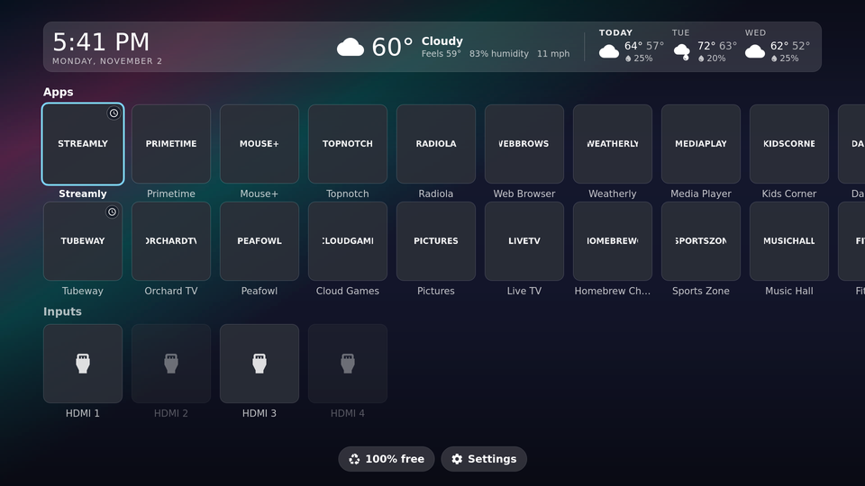

# elgie-man

A replacement Home screen for two rooted LG TVs: the CX on webOS 5.6.2 and the C5 on webOS 10.3.1 ("webOS 25"). Pressing Home shows this launcher instead of LG's Home: rows of apps, open apps and inputs, with no ads, promotions or recommendation rows.

It is not a copy of LG's Home. Some things behave differently ("What behaves differently"), and installing it changes more on the TV than a folder of files ("What it changes on the TV"). **Use it at your own risk.**



## How it runs

| TV | webOS | How |
|---|---|---|
| LG CX | 5.6.2 | LG's own Home program stays and loads the launcher's screens in place of LG's. |
| LG C5 | 10.3.1 | LG's Home app does not run. The TV's `qml-runner` runs the launcher under Home's app id. |

Both keep Home's app id, so the Home key still opens it. `docs/contract-cx.md` and `docs/contract-c5.md` record what each TV expects of a Home app, as observed.

## What behaves differently from LG's Home

- **Pause on Home.** Opening Home over an app first sends that app the remote's Pause, and Home appears when the app has answered (at most 0.7 s later; 1.6 s for apps that get Pause twice). Play is never sent. Switch: `pauseOnHome`.
- **CX, with `pauseUnderHome` on:** Home takes over the screen and the app under it goes to the background, where LG's Home sat on top of it. Back then reopens that app, or the last input if the app has closed. Some apps reload when reopened. The example config turns this off.
- **CX, at power-on:** if Home Auto Launch is on in the TV's settings, the launcher stays on screen until dismissed. LG's Home hid itself after a few seconds.
- **C5:** the Menu key opens the launcher in edit mode.
- **Not there:** ads, promotions, the hero banner, recommendation shelves, sports alerts, search, install progress, the account label, the quick guide and music. Weather is there only if you point it at a Home Assistant weather entity (`weather` in `config.json`).

## Left idle

LG's Home was not watched for comparison.

- **Over an input,** the TV closes Home after two minutes and the input stays (seen on the C5, and on the CX with `pauseUnderHome` off; not checked over an app).
- **With nothing under it** (the C5 with no app or input in front; the CX with `pauseUnderHome` on), the TV's screensaver comes up after about three minutes on the C5 and a little over two on the CX, and stays (one run each). On the C5, Home is closed and reappears once at two minutes first.
- **When Back ended the screensaver,** the CX showed Home again and the C5 showed its last input (seen once each).

## What you get

- **A bar at the top** with the clock and, from Home Assistant, the weather now and the next three days (high, low, chance of rain).
- **Rows:** apps in the order the TV reports them, flowing across the width and down as many rows as they need (eight to a row), with a clock badge on each app that is open; a System apps band under them for the apps you move there, which folds away to its name (OK on the name opens it again); inputs.
- **Hold OK on an app or input** for its menu: Open, Force stop (while it runs), Hide or Show, Move, and Move to System apps or back to Apps. Inputs get Open and Hide or Show.
- **A bar at the bottom:** a Free up memory button (a recycling icon and the share of the memory for apps that is free) and a Settings button, centered. The share is LG's own "usable" figure over the most that figure has been on this TV, so it reads near 100% with nothing open; "Reset launcher settings" starts that over.
- **Arrow keys or the remote's pointer.** The tile under the moving pointer takes the focus, a click is OK, and the wheel steps along a row. A click beside a menu closes it. Moving a tile in edit mode is done with the arrow keys.
- **Edit mode:** every app and input is shown, hidden ones dimmed, and OK opens the same menu; for bringing hidden tiles back.
- **Free up memory:** closes the apps on a list you choose.
- **Settings:** a page on the TV for theme, see-through background, accent color, clock, weather, the System apps band, edit mode, Pause on Home, the CX background switch, the Free up memory list and LG's own settings. A setting changed there is kept on that TV and wins over `config.json` until "Reset launcher settings".
- **Themes:** the glass look over your own picture, and two color schemes of it (`nord`, `gruvbox`), picked under Settings → Look → Theme. Writing your own is covered in [`qml/dashboards/README.md`](qml/dashboards/README.md).
- **The launcher makes no sounds of its own.** It does stop app sound in the cases above (Pause on Home, the CX background switch, Free up memory).
- **Headset** (CX): a button at the bottom that sends the TV's sound to a USB headset plugged into the TV, which webOS 5 cannot do itself. On, it switches Sound Out to Wired Headphones, turns SIMPLINK off (a receiver on HDMI ARC takes the sound back otherwise) and pipes the TV's mix into the headset; the button is tinted while it is on. It goes off from the button, when the headset is switched off (the dongle reports the dropped link on its USB serial port; the sound is back on the receiver about a second later), when the dongle is unplugged, on a resume from standby and at a reboot, and both settings go back. The button follows the TV's Sound Out setting, so it updates by itself. The TV's volume does not apply; the headset's own dial does. Needs the Homebrew Channel (its `exec` service runs the script as root). Switched-off detection is known to work with the Sony INZONE H9 dongle; a dongle without a serial port leaves the other ways.

## Requirements

**TV**

- **LG CX on webOS 5.6.2 or LG C5 on webOS 10.3.1.** `deploy.sh` refuses anything else unless forced.
- **Rooted, with a root shell on telnet port 23** whose prompt is `~ # `. Every command goes through it. Telnet has no password and no encryption.
- **Homebrew Channel,** for its boot-hook folder `/var/lib/webosbrew/init.d`.
- **Firmware updates blocked.** An update can change Home and how it is started.
- **Switched on** when you install. Installed in standby, the launcher does not start until the TV is next turned on.

**PC**

- **Linux** with bash, python3 (3.7 or later), `ip`, `timeout` and `tar`. ffmpeg for `set-background.sh`.
- **Reachable from the TV.** The TV downloads the package from the PC over plain HTTP on a port between 18000 and 18999, so a firewall on the PC must let the TV in.

## Install

```sh
cp config.example.json config.json        # optional; edit to taste
scripts/set-background.sh my-picture.jpg  # optional; makes backgrounds/bg.jpg
scripts/deploy.sh <tv-ip>
```

- **What it does:** copies the launcher to `/var/lib/elgie-man`, installs the boot hook for that TV, and runs it. The hook ends the running Home; the TV starts it again a few seconds later with the launcher. Then press Home.
- **Check it worked:** `deploy.sh` stops with an error if the TV could not download or unpack the package, but it does not wait for the launcher to start. Its last lines say whether Home's `qml` folder now holds the new files (`mounted: new files`); look for `launcher started` in `/tmp/elgie-man.log` on the TV about a minute later.
- **Config:** a local `config.json` replaces the one on the TV at every deploy. With none, the TV gets `config.example.json` on first install, which differs from the defaults (see the table below).
- **Background:** without `set-background.sh` there is no picture and glass shows a plain gradient.
- **Update:** run `deploy.sh` again.

### Other TVs

`deploy.sh` reads the TV's model and webOS version first and stops, with nothing copied, unless it is a CX on 5.6.2 or a C5 on 10.3.1. Any screen size or region of those two models passes; only one set of each has been tested.

```sh
FORCE=1 scripts/deploy.sh <tv-ip>
```

- **This installs anyway** and has never been tried on any other TV. The start check below is then the only thing that puts LG's Home back.
- **Method used:** a TV with `/usr/bin/flutter-client` gets the C5 method; every other TV gets the CX method.
- **Marker:** on a TV that is not a tested pair, a forced install leaves `/var/lib/elgie-man/force`, which switches off the boot hook's version check. A later install without `FORCE=1` removes it.

## What it changes on the TV

Nothing on the TV's read-only system image is written. The rest:

**Both**

- **Files:** `/var/lib/elgie-man` and the hook `/var/lib/webosbrew/init.d/05elgieman`.
- **At every boot** the hook mounts the launcher over part of Home's folder and ends the Home process once so it restarts with the launcher. The mounts do not survive a reboot; the hook makes them again.
- **App order:** moving a tile in edit mode changes the TV's own app order. It stays after uninstall.

**CX**

- **Mount over Home's `qml/` folder.**
- **Mount over LG's stored Home snapshot,** so the TV snapshots and restores the launcher instead. LG's copy is not written. The TV's temporary copy of the snapshot in `/tmp` is deleted.
- **Fallback:** if LG's stored snapshot folder is missing, or `/var/lib/elgie-man/no-snapshot` exists, the hook instead moves `/tmp/criu_enable` aside. That switches snapshot restore off for every app until it is put back.
- **Settings:** the launcher keeps its per-TV settings as an `[elgieman]` section in Home's own settings file, `/home/root/.config/Unknown Organization/com.webos.app.home.conf`.
- **Headset button:** while it is on, Sound Out is Wired Headphones and SIMPLINK is off; `/var/lib/elgie-man/headset.state` holds what they were. PulseAudio gets a source on ALSA `hw:0,12` (the TV's mix) and a `parec | pacat` pipe into the USB device, and a listener holds the dongle's serial port (`/dev/ttyACM0`), reading link events; it writes one status request when it starts. Off puts the settings back (SIMPLINK first) and removes all of it. The boot hook runs `headset.sh reset` at a real boot (uptime under 5 minutes) and the launcher runs it when the TV comes back from standby.

**C5**

- **Mount over Home's whole app folder.** The folder mounted there holds the launcher and a copy of Home's manifest with `type` and `main` changed.
- **Block and release:** to make the TV read that manifest, the hook blocks Home in the application manager and releases it at once. The TV writes the block to its blocked-apps list and removes it again. A power cut between the two leaves Home blocked until the hook runs at the next boot and releases it.
- **Settings:** in `/var/lib/elgie-man/settings.conf`.

## Safety nets

- **Start check.** 45 s after the TV next starts Home, the hook checks that the launcher recorded a start. If not, it removes the mounts, turns itself off and shows a toast, and stays off until the next `deploy.sh`. It checks only that the launcher's code ran, not that the screen is right. Tested on both TVs.
- **Health check.** After each start check the hook compares the number of inputs and the sound output with what they were at the last install that could read them, and shows a toast if either differs. It changes nothing. After changing the sound output yourself, running `deploy.sh` again records the new one (not tested with a changed output).
- **Version check.** At every boot the hook compares the webOS version with the tested one. If it differs, the hook does nothing, LG's Home stays and a toast says so. A firmware update that keeps the same webOS version number is not caught. Tested at real boots on both TVs with the hook's expected version changed: LG's Home stayed and the toast showed.
- **Fault guard (C5).** Two boots in a row that the TV records as fault restarts turn the hook off. Never triggered for real; only its reading of the boot reason has been checked.
- **Off switch.** `touch /var/lib/elgie-man/disabled` on the TV, then reboot. The next `deploy.sh` removes it.
- **A theme that fails to load** shows a plain message and Back still closes Home. Tested on the C5 only.

## Uninstall

```sh
scripts/uninstall.sh <tv-ip>
```

- **Removes** the hook, the mounts, `/var/lib/elgie-man` and (CX) the `[elgieman]` settings section, then ends Home so LG's starts. Tested on both TVs.
- **The launcher's settings on that TV go with it:** the hidden list and anything changed in the settings panel.
- **Does not restore** an app order changed in edit mode.
- **If a mount will not come off, or (C5) Home stays blocked,** it stops with exit code 1, removes nothing more and says what to do. The hook is left switched off. These failure paths have not been seen or tested.
- **C5:** it runs a script that the install left on the TV. If that file is gone, nothing is undone and it exits 1.
- **Not gated:** it runs on any TV.

## Tested, and not

**Tested on one CX and one C5:** install and update, Home and Back, launching apps and inputs, edit mode, the settings panel, the theme picker, reboot, standby and power-on, the start check reverting a broken install, uninstall and reinstall.

**Tested on both, once each:** the overnight suspend and morning wake (CX: on an earlier build); what happens when Home is left idle ("Left idle").

**Tested on the CX only:** restoring the launcher from a snapshot (the C5 does not use one).

**The current look** (the flowing app rows, the bars at the top and bottom, the weather, the settings page, edit mode and its menu) was checked on the CX and the C5 once each, with the weather coming from Home Assistant, and with `lab/preview.sh` on a PC. Moving a tile a row up or down (one reorder call over a whole row) was tried on the PC and the Gym once. The hold-OK menu (with an injected key held 0.9 s and 2 s), moving an app to System apps and back, and folding and unfolding the band were checked on both once. With the Magic Remote's pointer showing, a held OK is a held click; the tile under the pointer ignores the pointer's movement while the button is down, so the menu keeps the focus (reported once, fixed, not re-tried by hand).

**Pointer:** tried by hand with the remote on the CX and the C5, and reported working on both. Hover, click, wheel and the menus were not checked one by one.

**Headset (2026-11-04, Living Room CX, Sony INZONE H9 dongle):** the whole path was run by hand from a verified idle TV: button on with the headset connected (sound in the headset, nothing from the receiver), headset switched off (one toast, the receiver playing again one second after the dongle reported the drop, SIMPLINK back on). The two mix taps (`hw:0,12` and `hw:1,2`) were recorded together and found sample-identical. Not yet tried: the reset at a real boot and at a resume from standby, the teardown when the dongle is unplugged, the button on the C5, and the headset icon in the GFN app's dev build.

**Not tested:**

- picture and sound from HDMI sources with the launcher installed, by eye and ear;
- Pause on Home with every app (checked: YouTube TV, YouTube, Netflix, Apple TV, Peacock, Paramount+; Prime Video and Max only at their browse screens, with no title playing);
- any TV other than those two, and any other firmware.

**Known problems:**

- **Seen twice on the CX (2026-11-02):** after `deploy.sh` ended Home, the TV kept trying to relaunch it every few seconds and it never came up; the hook's failsafe reverted to LG's Home after 45 s, and `deploy.sh` run again then worked. Both times the launcher it replaced had been up for under five minutes; deploys over a launcher up for ten minutes or more went through. Cause unknown.

- **Seen once on the C5:** after an install made while Home was on screen, Home came up black and took no keys until its process was ended. Not reproduced.
- **Never run `ls-monitor` on a webOS 25 TV.** It made the C5 record a fault and restart (`docs/contract-c5.md`). The launcher does not use it.

## config.json

"Default" is what the launcher uses when the key is absent. "Example" is what `config.example.json` sets, where that differs.

| Key | Default | Example | What it does |
|---|---|---|---|
| `accent` | `#7dd3fc` | | Color of the focus ring and highlights. `nord` and `gruvbox` have their own set and ignore other colors. |
| `backgroundOpacity` | `1` | `0.85` | Below 1, the app behind Home shows through the background (C5, and CX with `pauseUnderHome` off). |
| `pauseOnHome` | `true` | | Send Pause to the app in front before Home appears. |
| `pauseTwiceApps` | `["com.cbs-all-access.webapp.prod"]` | | App ids that get Pause twice: the first only brings up their player controls. |
| `pauseUnderHome` | `true` | `false` | CX only. `true`: Home takes over the screen and the app goes to the background. `false`: Home sits on top and the app stays in front. |
| `freeMemoryApps` | `[]` | ten app ids | App ids closed by Free up memory. |
| `systemApps` | `[]` | seven launch point ids (LG's browser, gallery, music, photos, sports, Home Dashboard, Alexa) | Launch point ids (`<app id>_default`) shown in the System apps band instead of Apps. Changed on the TV with the hold menu. |
| `systemAppsCollapsed` | `false` | | Fold the System apps band to its name. Changed on the TV with OK on the name, or under Settings → Rows. |
| `memoryPeakMb` | | | Kept by the launcher itself: the most memory LG's memory manager has reported as usable for apps, the 100% of the Free up memory button. |
| `settingsId` | `com.palm.app.settings` | | App id opened by the Settings tile. |
| `showClock`, `showWeather` | `true` | | Show the clock, the weather. |
| `weather` | none | | `{"url": "http://<home-assistant-ip>", "token": "<long-lived access token>", "entity": "weather.<name>"}`. The launcher reads the entity's state and its daily forecast over Home Assistant's REST API when Home is shown (at most every 10 minutes) and every 15 minutes while it stays up. An IP address, not a name: the TVs do not resolve hostnames. The token is in `config.json` on the TV, readable by root only. |
| `sendspin` | `false` | | Send TV sound to Music Assistant. Read by elgie-sendspin (separate repo), which starts or stops its Sendspin source to match; does nothing without it. |
| `dashboard` | `glass` | | The theme the TV starts with. A theme picked on the TV wins. |
| `demo` | `false` | | Stand-in app names and no app icons, for screenshots. |
| `debug` | `false` | | C5 only: keep the host's last 60 log lines in `debugLog` in `/var/lib/elgie-man/settings.conf`, with a line for each key press that reaches the host (not the arrows and OK that a tile or menu handles). Not re-tested since it was made a switch. |

## Where things are

| Path | What |
|---|---|
| `qml/Shell.qml`, `qml/Luna.qml`, `qml/models/` | The frame every theme runs in: bus calls, app/input/memory data, show and hide. |
| `qml/hosts/cx/`, `qml/hosts/c5/` | The QML file that differs per TV. |
| `qml/dashboards/` | The themes. |
| `qml/ui/` | Parts of the glass theme, reusable. |
| `init.d/` | The boot hooks, one per TV. |
| `tv/` | Scripts that run on the TV: `headset.sh`, the USB headset route (installed as `/var/lib/elgie-man/headset.sh`). |
| `scripts/` | Install, uninstall, background. |
| `docs/` | What each TV expects of Home; screenshots. |
| `lab/` | Tools for testing on a TV: screenshots, key presses, state snapshots. `lab/preview.sh` runs the launcher on the PC with made-up apps and takes screenshots. |

On the TV: files in `/var/lib/elgie-man`, the hook in `/var/lib/webosbrew/init.d/05elgieman`, the hook's log in `/tmp/elgie-man.log`.

## License and origin

Apache-2.0 (`LICENSE`). The code was written for this project; what was consulted is in [`THIRD_PARTY.md`](THIRD_PARTY.md). Not affiliated with LG.
