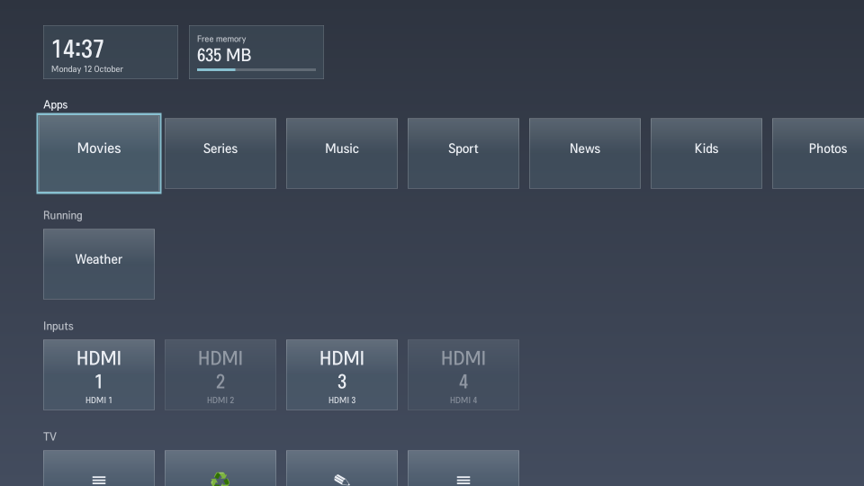
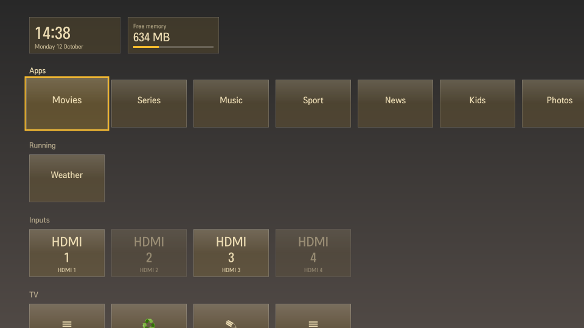

# Dashboards

A dashboard is what the TV shows when Home is pressed. Each one is a folder here with a `Dashboard.qml` in it. The frame around it (`qml/Shell.qml` and the two hosts in `qml/hosts/`) deals with the TV: the Home and Back keys, showing and hiding the window, start-up, snapshots and the failsafe. A dashboard only draws and reacts to keys.

| Folder | What it is |
|---|---|
| `glass/` | The launcher: tile rows for apps, running apps, inputs and TV actions, edit mode, settings panel. |
| `nord/` | `glass` in the Nord colours: cool blue-greys, frost accents. A few lines that set a palette. |
| `gruvbox/` | `glass` in the Gruvbox dark colours: warm browns, cream text, bright accents. |
| `starter/` | The time and one row of app names. About 50 lines; copy it to begin. |

## What they look like

Taken on a webOS 25 TV with `"demo": true` in `config.json`, which swaps the app names for stand-ins and leaves out the icons in the Apps row. The Settings tile still shows the TV's own settings icon.

| | |
|---|---|
|  `glass` |  `nord` |
|  `gruvbox` | |

## Themes on the TV

- **All installed:** `deploy.sh` sends every dashboard here to the TV (not `starter/`).
- **Picking one:** Launcher settings → Look → Theme. The choice is kept on that TV.
- **Start-up:** the TV loads the dashboard chosen at deploy time, then swaps to the picked one. A picked dashboard that does not load gives way to the deployed one.

## A colour scheme of glass

Copy `nord/` and change the values. `palette` has `top` and `bottom` (the background, in place of the picture), `panel` (the settings panel and text on the accent colour), `ink` (text), `glass` (the tint of the tiles) and `accents` (the choices under Accent colour; the first is the default).

## One dashboard, both TV families

- **Shared:** `Shell.qml`, `Luna.qml`, `models/`, `ui/` and every dashboard are the same files on webOS 5 (CX) and webOS 25 (C5).
- **Different:** only `main.qml`, the host (`qml/hosts/cx/` and `qml/hosts/c5/`). `deploy.sh` picks it by checking the TV.
- **What a dashboard can still see of the difference:** `tv.overlayOnly` (true on webOS 25), and `activateType` (`recent` for a long press on webOS 5, `myapps` for the Menu key on webOS 25).

## Make one

1. Copy `starter/` to `qml/dashboards/<your-name>/`.
2. Edit `Dashboard.qml`. Add more `.qml` files or images to the folder as needed; the whole folder is sent to the TV.
3. Give it an entry that calls `tv.pickTheme()`, so people can leave it for another theme.
4. Install: `scripts/deploy.sh <tv-ip>`, then pick it on the TV under Launcher settings → Look → Theme. `"dashboard": "<your-name>"` in `config.json` makes it the one the TV starts with; `DASHBOARD=<your-name>` does the same when `config.json` has no `dashboard` key. A theme already picked on the TV still wins.
5. Add a screenshot to `docs/dashboards/` taken with `"demo": true`, and a row to the tables above.

## What a dashboard is

- **Root item:** a `FocusScope` (or any `Item`) with `property var tv`. The frame sizes it to the screen, 1920×1080.
- **Functions the frame calls.** All are optional.

| Function | When | Notes |
|---|---|---|
| `start()` | Every launch of Home's process, and again after the TV restores it from a snapshot. | Make bus calls and network requests here. Must be safe to call twice. |
| `activate(params)` | Each time Home is shown. | `params.activateType` is `home`, `recent` (long press on webOS 5) or `myapps` (Menu key on webOS 25). Put focus where it should start. |
| `deactivate()` | Each time Home is hidden. | Close any menus. |
| `back()` | Back was pressed. | Return `true` if the dashboard used the key (closed a menu, say). Otherwise Home hides. |

- **Keys:** arrows, OK (`Keys.onReturnPressed` and `Keys.onEnterPressed`) and the rest arrive as normal Qt key events on the item with focus. Back and Home are handled by the frame.

## What `tv` gives you

| Member | What it is |
|---|---|
| `tv.shown` | `true` while Home is on screen. Run timers and animations only then. |
| `tv.now` | The current `Date`, refreshed every second while shown. |
| `tv.config` | `config.json` with the settings changed on this TV on top. Read your own keys from it. |
| `tv.flag(key)` | `true` unless `config[key]` is `false`. |
| `tv.store.set(key, value)` | Saves a setting on this TV; `tv.config` updates. `tv.store.reset()` clears them all. |
| `tv.dataDir` | `file:///var/lib/elgie-man/`, where `config.json`, `bg.jpg` and `bg-blur.jpg` are. |
| `tv.launch(id, params)` | Opens an app or input. |
| `tv.hide()` | Hides Home. |
| `tv.pickTheme()` | Opens the list of installed dashboards over yours. `tv.theme` is the name of the one in use, `tv.themes` the list. |
| `tv.apps` | `shown` and `all`: lists of `{launchPointId, id, title, icon, color, params}` in the TV's order. `toggleHidden(launchPointId)`, `isHidden(launchPointId)`, `step(launchPointId, ±1, list, done)` to move a tile. |
| `tv.inputs.items` | `{label, id, connected, active}` for each input. |
| `tv.running.items` | `{id, title, icon, color}` for each open app. |
| `tv.foreground` | `appId` of the app in front, `lastApp`, `lastInput`, `isInput(id)`. |
| `tv.memory` | `totalMb`, `availableMb`, `freeRatio`; refreshed every 5 s while shown. |
| `tv.bus.call(service, method, params, cb)` | Any other luna call, made as Home. `cb(ok, response)`. With `subscribe: true` it returns a handle for `tv.bus.cancel(handle)`. |
| `tv.overlayOnly` | `true` on webOS 25, where Home always sits on top of the app in front. |

The glass parts in `qml/ui/` (`GlassTile`, `GlassCard`, `TileRow`, `FocusRing`, `Sheet`, `Toast`, `SettingsPanel`) can be used with `import "../../ui"`.

## Rules

- **QtQuick 2.7 and ES5 only.** The CX TVs run Qt 5.9: no `let`, `const`, arrow functions or template strings.
- **Nothing that talks to the bus or the network while the file loads** (`Component.onCompleted`, property initialisers). On webOS 5 the TV snapshots the process right after loading, and a connection inside a snapshot is dead when it is restored. Use `start()`.
- **Do not create your own repeating timers at the top level** for the same reason; bind to `tv.now`, or create timers in a `Loader` that `start()` switches off and on.
- **Leave the window see-through or not as you like.** Nothing is drawn behind the dashboard; the app in front shows through anything not painted.
- **Hostnames do not resolve on the TVs.** Use IP addresses for requests.
- **No sound.**
- **No one else's names, logos, characters, lettering or artwork,** including in a look that is "inspired by" something. Use fonts already on the TV by name; do not ship font files without their licence.
- **Your own work only,** under the repo's licence (Apache-2.0). No code, layouts, images, icons or text taken from LG's software. Name the source and licence of anything else you include.

## If it does not load

- A `Dashboard.qml` with an error shows "The dashboard did not load" when Home is pressed; Back still closes Home. The TV keeps working.
- The error text is in the TV's log: `/var/log/dbg-log` on webOS 25. On webOS 5 the system log drops app messages; check the file on a webOS 25 TV or with Qt's tools on a PC.
- An error inside `start()`, `activate()`, `deactivate()` or `back()` is caught and logged; Home still shows and hides.
